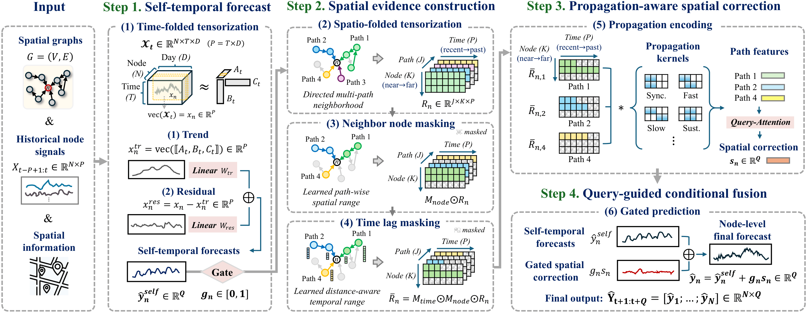

# CriSTal

This is the official implementation of **CriSTal** (*Conditional Spatial Evidence
Retrieval for spatio-temporal traffic forecasting*) (KDD 2027).

## Overview of CriSTal



---
CriSTal first predicts each node from its **own time-folded temporal structure**,
then uses a **residual-driven gate** to decide *whether* spatial evidence is
needed at all. When it is, the model retrieves propagation-relevant neighbors
along **directed incoming paths** with query-adaptive spatial and temporal
ranges, encodes them with propagation kernels, and adds the result as a **gated
residual correction**.

## Requirements
We recommend using the following versions of packages:
- Python 3.8+
- PyTorch 1.12+ (2.x recommended)
- NumPy, SciPy
- pandas *(only for `.h5` speed files, e.g. METR-LA / PEMS-BAY)*

Example install:
```bash
pip install -r requirements.txt
# Install PyTorch from the official instructions for your CUDA/CPU environment.
```

---

## Repository entry points

- `cristal/train.py` — train / evaluate CriSTal (single command, end-to-end)
- `cristal/model.py` — the CriSTal model (self branch, gate, spatial retrieval, fusion)
- `cristal/graph.py` — directed distances and incoming-path construction
- `cristal/initialize.py` — CP lookup-table initialization
- `cristal/data.py` — dataset loading, adjacency, windowing, periodic reference
- `cristal/metrics.py` — MAE / RMSE / MAPE by horizon

---

## Data Overview

CriSTal handles both **short-term** traffic forecasting and **long-term**
air-quality / streamflow forecasting. Two ready-to-run datasets, **PEMS08**
(short-term) and **KnowAir** (long-term), are included under `data/`. Download
the others from the standard community release and place them under
`data/<DATASET>/`.

|      **Dataset**       |  **Horizon**   |                     **Link**                     |
|:----------------------:|:--------------:|:------------------------------------------------:|
|      **PEMS04**        |   short-term   |        `https://www.kaggle.com/datasets/wenkeda/pems04`     |
|      **PEMS07**        |   short-term   |        `https://www.kaggle.com/datasets/shlokkaushik/pems07`     |
|    **PEMS08** *(incl.)* |   short-term   |        `https://www.kaggle.com/datasets/jvthunder/traffic-flow`     |
|      **METR-LA**       |   short-term   |        `https://huggingface.co/datasets/witgaw/METR-LA`      |
|     **PEMS-BAY**       |   short-term   |        `https://zenodo.org/records/4263971`      |
|   **KnowAir** *(incl.)* |   long-term    |     `https://github.com/shuowang-ai/PM2.5-GNN`   |
|     **LamaH-CE**       |   long-term    |        `https://zenodo.org/records/4525244`      |

## Dataset format

### Directory layout

```text
data/<DATASET>/
  # PEMS04 / PEMS07 / PEMS08
  PEMSxx.npz          # key 'data', traffic-flow channel 0
  PEMSxx.csv          # from,to,cost  (directed road distances)

  # METR-LA / PEMS-BAY
  speed_data.npy      # (L, N) float, OR the original <name>.h5
  adj_mx.pkl          

  # KnowAir (long-term)
  data.npy            # (L, N) PM2.5, or the raw (L, N, C) with PM2.5 in channel 17
  adj.npy             # (N, N) directed connectivity
  city.txt            # index name lon lat   (for physical-distance corridors)

  # LamaH (long-term)
  qobs.npy            # (L, N) streamflow
  adj.npy             # (N, N) upstream->downstream connectivity
  coords.npy          # (N, 2) projected coordinates in metres (optional)
```

---

## 1) Train

Training is a **single command** — it loads the data, builds incoming paths, trains end-to-end, selects the gate threshold `θ` on validation, and reports the test scores.


Each dataset selects its own forecasting horizon, temporal fold, sampling rate,
and corridor distance automatically; a single command works for both short- and
long-term settings.

```bash
# short-term (included)
python -m cristal.train --dataset pems08 --data_dir data/PEMS08
# long-term (included)
python -m cristal.train --dataset knowair --data_dir data/KnowAir
```

Other datasets:

```bash
python -m cristal.train --dataset pems04   --data_dir data/PEMS04
python -m cristal.train --dataset pems07   --data_dir data/PEMS07
python -m cristal.train --dataset metr-la  --data_dir data/METR-LA
python -m cristal.train --dataset pems-bay --data_dir data/PEMS-BAY
python -m cristal.train --dataset lamah    --data_dir data/LamaH
```


## 2) Evaluation

### Test-only 

```bash
python -m cristal.train --dataset pems08 --data_dir data/PEMS08 \
    --eval_only --ckpt runs/cristal_pems08.pt
```

---

## Configuration

**Per-dataset settings** are applied automatically from `--dataset`; the flags
below override them if given.

| Dataset            | `P` / `Q` | `fold_D` | `steps_per_day` | 
| ------------------ | :-------: | :------: | :-------------: | 
| PEMS04/07/08, METR-LA, PEMS-BAY | 12 / 12 | 1 | 288 | 
| KnowAir            |  48 / 24  |    6     |        8        | 
| LamaH-CE           | 168 / 24  |    7     |       24        | 


The whole model is trained end-to-end with an L1 forecasting loss and the CP reconstruction term. 


## Repository layout

```text
cristal/
  data.py        dataset loading, adjacency, windowing
  graph.py       directed distances and incoming-path construction
  initialize.py  CP lookup-table initialization 
  model.py       the CriSTal model
  metrics.py     MAE / RMSE / MAPE
  train.py       training and evaluation
```
## Reference

If you use this code, please cite the following paper.
```bibtex
@inproceedings{lee2027cristal,
  title={CriSTal: Conditional Spatial Evidence Retrieval for Accurate Spatio-Temporal Forecasting},
  author={Lee, SeungJoo and Park, Yong-chan and Lee, Jeongyoung and Kang, U},
  booktitle={Proceedings of the 33rd ACM SIGKDD Conference on Knowledge Discovery and Data Mining V. 1},
  year={2027}
}
